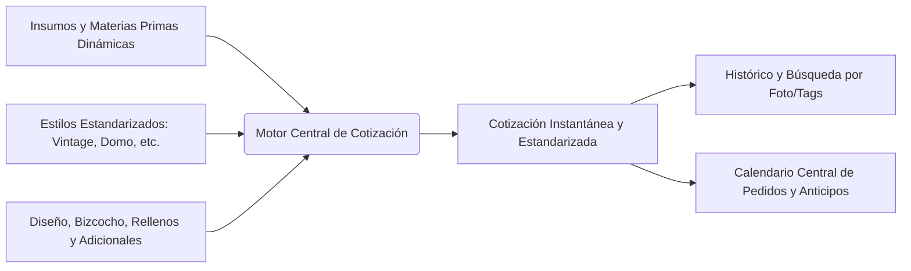
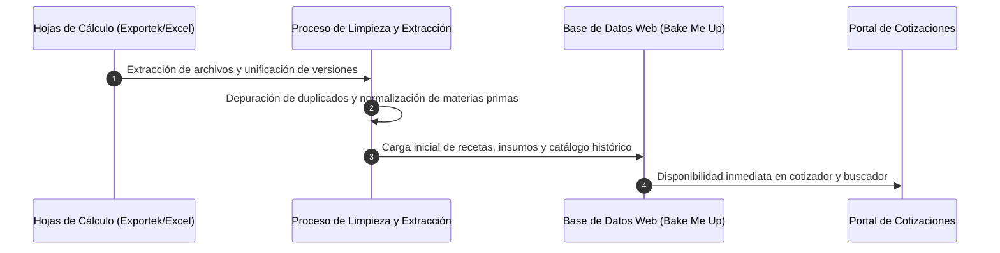

# Propuesta de Sistema: Migración, Cotizador Web Dinámico e Histórico
**Proyecto:** Bake Me Up  
**Fecha de reunión:** 12 de octubre de 2026  
**Participantes clave:** Sofia Gavito Alarcón, Carlos Ruiz (Woody), Lalo  
**Estado:** Documento de especificación y propuesta técnica  

---

## 1. Resumen Ejecutivo

Actualmente, **Bake Me Up** gestiona sus cotizaciones y pedidos a través de múltiples hojas y libros de cálculo (Exportek / Excel / Google Sheets). Debido al rápido crecimiento en el volumen de solicitudes y la alta volatilidad de los precios de insumos (como incrementos significativos en materias primas como el huevo), el método actual presenta fallas críticas de desactualización, discrepancias de precios según el personal que atiende y fragmentación de la información.

Esta propuesta detalla la **migración integral del motor de cotizaciones y gestión de pedidos a la plataforma web de Bake Me Up**, sustituyendo por completo las hojas de cálculo por un sistema centralizado, intuitivo y automatizado.

---

## 2. Diagnóstico: Situación Actual (As-Is) vs. Solución Propuesta (To-Be)

| Dimensión | Situación Actual (Excel / Hojas Sueltas) | Solución Propuesta (Portal Web Bake Me Up) |
| :--- | :--- | :--- |
| **Fluctuación de Insumos** | Modificar un costo requiere actualizar manualmente múltiples fórmulas; los históricos quedan desfasados. | **Matriz Dinámica:** Al cambiar el costo de un insumo (ej. huevo, mantequilla), el costo base de todas las fórmulas se actualiza automáticamente en cascada. |
| **Consistencia de Cotización** | Variación de precios dependiendo de la persona en mostrador/atención que realiza el cálculo. | **Estandarización Total:** Reglas de negocio fijas. Cualquier integrante del equipo ingresa los datos y obtiene exactamente el mismo precio. |
| **Cálculo de Mano de Obra y Betún** | Cálculo manual y propenso a errores según el tamaño. | **Parámetros por Estilo:** Al seleccionar estilo (Vintage, Domo, Clásico) y porciones, el sistema calcula automáticamente cantidad de betún y tiempo invertido. |
| **Búsqueda de Referencias** | Archivos dispersos y dificultad para localizar pasteles previos similares. | **Histórico Inteligente:** Búsqueda por descripción, etiquetas y catálogo fotográfico (con capacidad de búsqueda visual). |
| **Agendamiento y Anticipos** | Uso fragmentado de Notion, Google Calendar y notas en mostrador. | **Calendario Integrado:** Registro de fecha, hora de entrega, monto abonado y saldo pendiente en una sola vista del portal. |
| **Integridad y Control de Versiones** | Riesgo de duplicidad de archivos o sobreescritura errónea. | **Base de Datos Centralizada:** Auditoría de cotizaciones, versionado automático y respaldos continuos. |

---

## 3. Módulos del Sistema Web

### Módulo 1: Catálogo y Matriz de Materias Primas Dinámicas
* **Gestión de Insumos:** Registro de materias primas con unidad de medida y costo de adquisición vigente (harinas, lácteos, huevo, chocolate, etc.).
* **Regla de Costeo Base de Bizcocho:** Dado que el sabor final no debe castigar el margen, el costeo base asume la receta estándar con los ingredientes de mayor costo para garantizar rentabilidad en cualquier elección del cliente.
* **Actualización en Cascada:** Al editar el precio de un ingrediente, el sistema recalcula los costos de recetas base sin necesidad de intervenir fórmulas individuales.

### Módulo 2: Motor de Cotización Estandarizado (Web Quoting Engine)
Interfaz ágil optimizada para cotizar en mostrador o vía WhatsApp en menos de 1 minuto:
1. **Datos del Pedido:**
   - Fecha y hora de entrega.
   - Número de personas / porciones.
2. **Estilo y Estructura:**
   - Selección de estilo predefinido (ej. *Vintage*, *Forma de Domo*, *Minimalista*, *Pisos múltiples*).
   - Cálculo automático de volumen de betún requerido.
   - Cálculo automático de tiempo de elaboración (mano de obra).
3. **Sabores y Rellenos:**
   - Sabor de pan / bizcocho.
   - Sabor de relleno.
4. **Adicionales y Acabados (Add-ons):**
   - Impresiones comestibles.
   - Flores (naturales o preservadas).
   - Decoraciones en papel / toppers personalizados.
   - Bases o decoraciones en MDF / acrílico.
5. **Cálculo Financiero:**
   - Costo de materia prima + Mano de obra + Gastos fijos/extras + Margen de ganancia deseado = **Precio Sugerido**.
   - Resumen para el cliente (desglose o precio final limpio) y opción de generación de comprobante/PDF.

### Módulo 3: Histórico y Búsqueda de Diseños
* **Ficha de Cotización Histórica:** Cada cotización guarda fotografía de referencia, especificaciones, fecha y precio emitido.
* **Recálculo Comparativo:** Capacidad de consultar una cotización pasada y ver:
  - *Precio al que se cotizó originalmente.*
  - *Costo actual equivalente con los precios de insumos de hoy.*
* **Búsqueda Avanzada:**
  - Búsqueda textual por palabras clave (ej. "flores rosas", "domo bautizo", "vintage corazón").
  - Filtrado por rango de personas, rango de precio o estilo.
  - Motor de búsqueda por similitud de imagen / fotografías de referencia.

### Módulo 4: Calendario de Producción y Gestión de Pedidos
* **Centralización de Entregas:** Vista de calendario (mensual, semanal, diaria) dentro del portal web.
* **Control de Pagos:**
  - Monto total cotizado.
  - Anticipo recibido (registro de método de pago y fecha).
  - Saldo pendiente contra entrega.
* **Sincronización:** Posibilidad de enlace vía API/Webhook con Google Calendar para notificaciones del equipo operativo.

---

## 4. Plan de Migración de Datos (Exportek / Excel a la Web)

1. **Fase de Consolidación:**
   - Depuración de copias redundantes de Excel para aislar la versión definitiva maestra.
   - Extracción de fórmulas vigentes de betún, tiempos de mano de obra y costos de adicionales (MDF, flores, obleas).
2. **Normalización del Modelo de Datos:**
   - Tabla de Insumos (`ingredients`).
   - Tabla de Fórmulas y Recetas (`recipes_matrix`).
   - Tabla de Estilos y Coeficientes (`styles_config`).
   - Tabla de Cotizaciones e Histórico (`quotes_history`).
   - Tabla de Pedidos y Calendario (`orders_schedule`).
3. **Carga y Verificación:**
   - Validación cruzada: cotejar cotizaciones manuales recientes con el resultado arrojado por el nuevo motor web para verificar que los márgenes coincidan al centavo.

---

## 5. Próximos Pasos y Asignación

- [ ] **Woody / Lalo:** Diseñar el esquema de base de datos y evaluar la infraestructura técnica del cotizador dentro del repo de Bake Me Up.
- [ ] **Woody / Lalo:** Evaluar la arquitectura del motor de búsqueda de imágenes (etiquetado inteligente vs. embeddings visuales ligeros).
- [ ] **Sofi:** Compartir el archivo maestro de Excel limpio con las fórmulas de cálculo de betún, proporciones por porción y catálogo de costos actuales de materia prima.
- [ ] **Sofi / Woody:** Validar los estilos estándar iniciales (Vintage, Domo, etc.) y los costos fijos de insumos extra (MDF, flores, impresiones comestibles).
